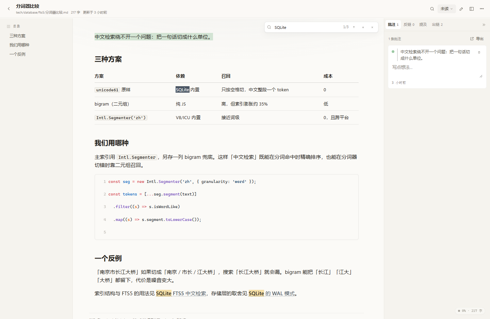
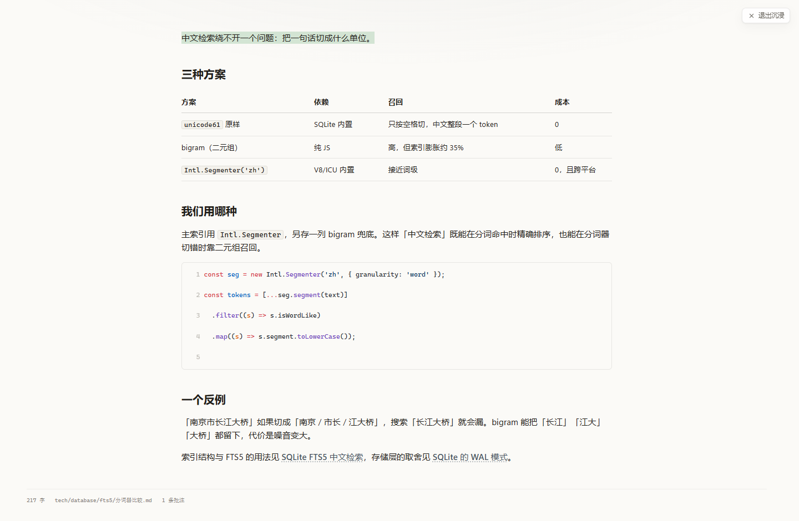
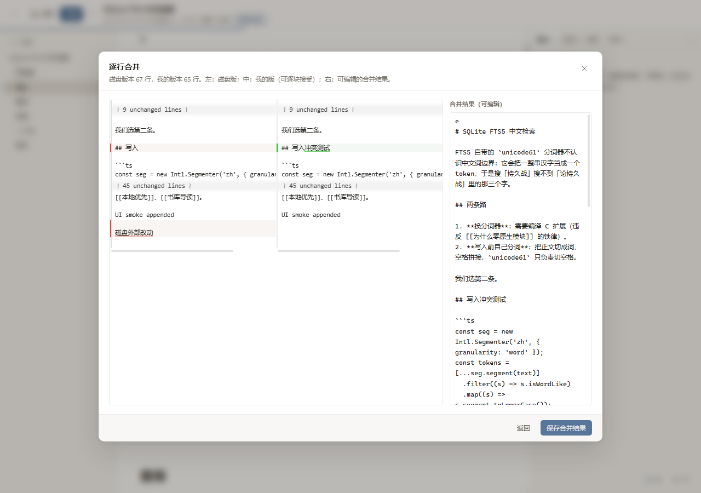
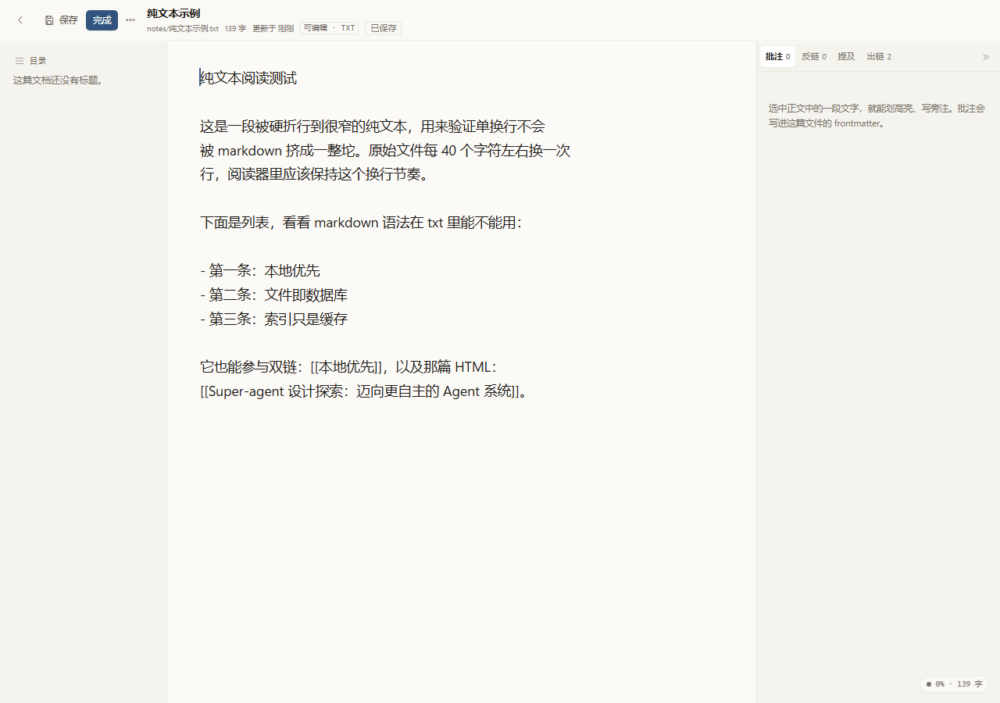
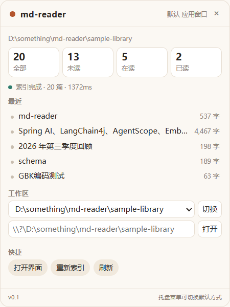
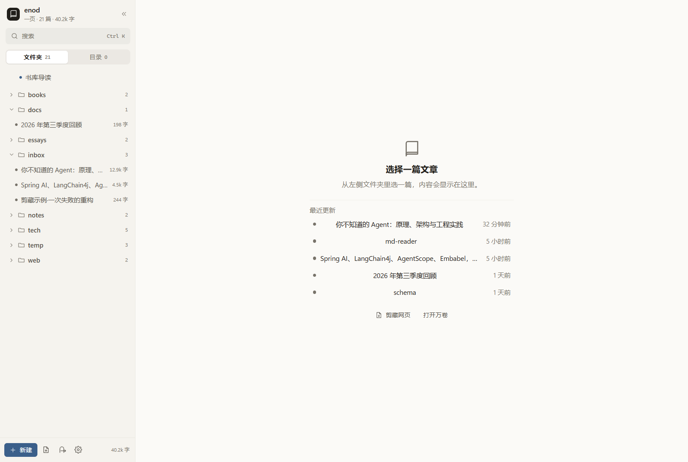
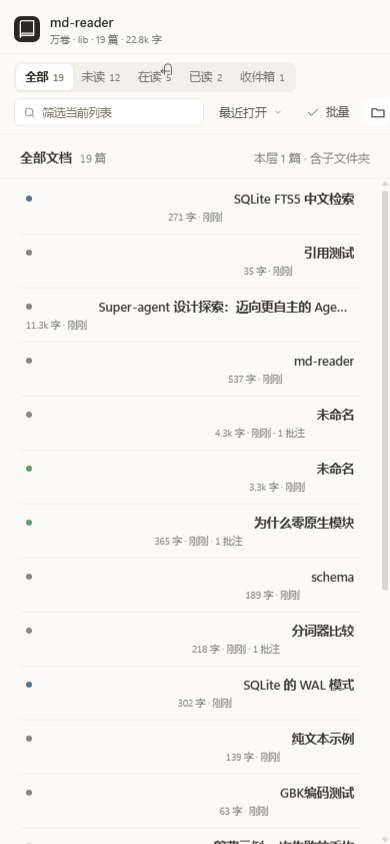
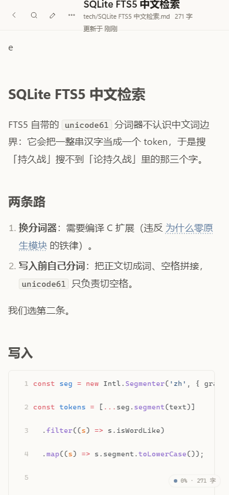
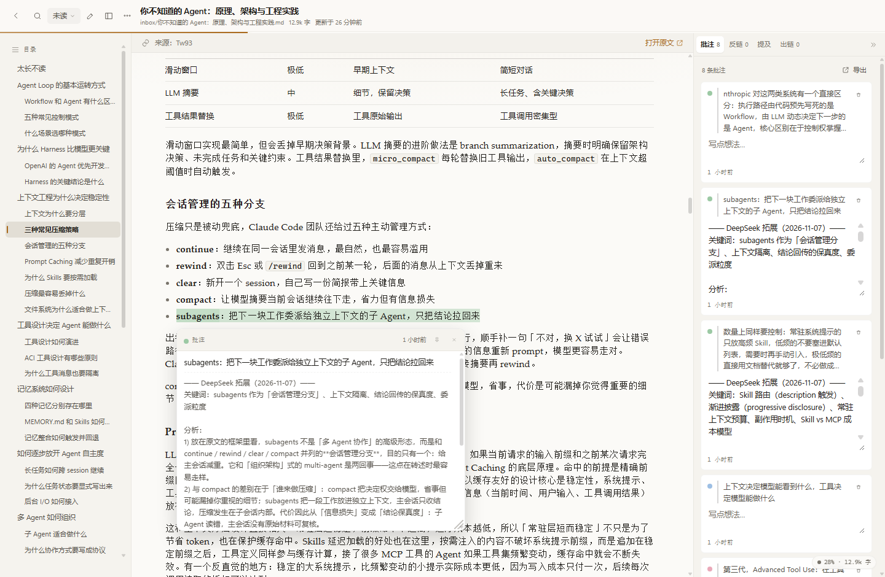
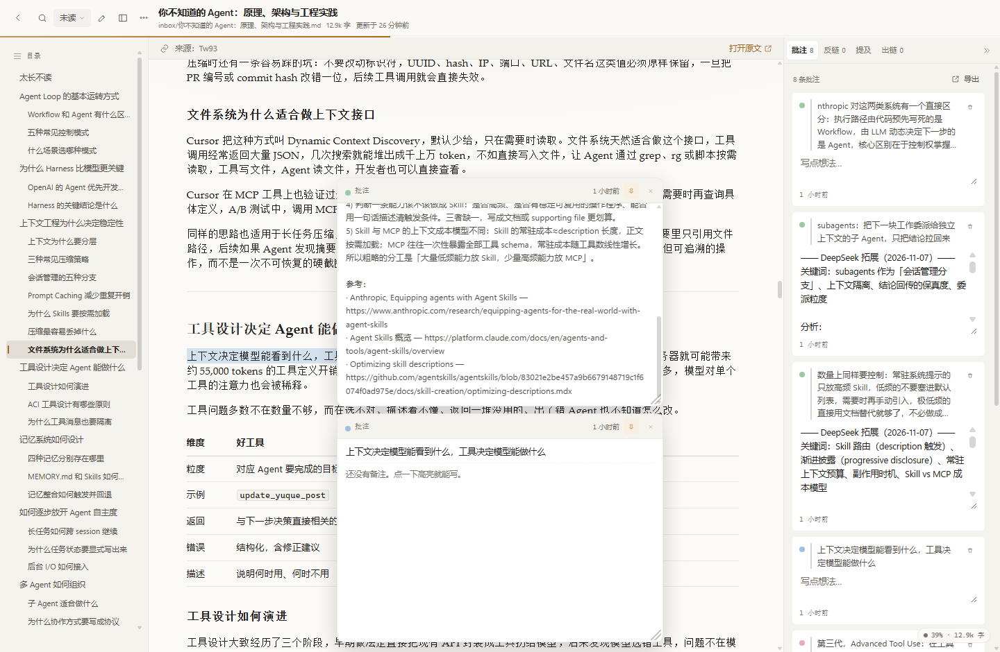

# enod

> 原名 `md-reader`（仓库/包名沿用），2026-11-07 起产品名改为 **enod**。

把你硬盘里的 `.md` 变成一个**能舒服地读、能直接改、能全局搜、能划线批注、能互相链接**的私人书库。

本地优先：文件就是数据库。元数据、批注、链接全部写在 Markdown 的 frontmatter 与正文里，同步交给坚果云 / WebDAV / Git 即可。

> **当前状态：v4 内核已落地（Rust）**。Node ↔ Rust 契约 **23/23**、转换金标准 **6/6 逐字一致**、中文分词召回 **98.01%**；
> txt/sql 可编辑、docx 批注 + 转 md、三栏 diff3、真浏览器 e2e **12/12**。
> Windows NSIS **6.86 MiB**、Linux deb **9.19 MiB** 已装通；macOS 等 runner。
> 逐项验收见 [docs/V4-STATUS.md](docs/V4-STATUS.md)，版本演进见 [docs/TRACK.md](docs/TRACK.md)。
> 需求基线：[PRD-v3.md](../PRD-v3.md)（v4 的 PRD 未随仓库分发，见 [TRACK §9](docs/TRACK.md#9-当前未闭环)）。


---

## 现在能做什么

| 能力 | 状态 | 说明 |
|---|---|---|
| **一页**（默认） | ✅ | 左侧文件夹 / 目录两个 tab + 中间文章；**右侧批注 / 反链面板（`Ctrl+Shift+B`）**；侧栏可收起为 46px 图标导轨（`Ctrl+B`）；文内查找 `Ctrl+F` |
| **万卷** | ✅ | 书架（文件夹 / 卡片 / 列表 / 标签）+ 三栏阅读 + 状态导航，可随时切回一页 |
| 书架 | ✅ | 四种视图（文件夹 / 书架 / 列表 / 标签）、嵌套文件夹树、状态分组、标签筛选、排序、虚拟滚动、批量改状态 / 打标签 |
| 阅读器 | ✅ | 桌面化外壳；**文档 / 专注 / 沉浸三种布局**；TOC 高亮；右侧批注面板可收成边缘把手（`Ctrl+Shift+B`）；**批注高亮悬浮即显示备注卡片**；**目录 / 批注栏可分别收起，边界拖拽调宽**；**文内查找（Ctrl+F）**；图片灯箱；Shiki 代码高亮 + 行号 + 复制；KaTeX、脚注、任务列表；三主题 + 6 强调色 + 两档密度 |
| 写作 | ✅ | CodeMirror 6 + Live Preview（隐藏标记、标题变大、图片内联、复选框可点）、800ms 自动保存、`Ctrl+S`、冲突检测、粘贴图片 |
| 冲突处理 | ✅ | **三栏 diff3**：磁盘版 / 我的版（行级 diff，可滚动对齐）/ 可编辑合并结果；≤900px 自动降为单栏堆叠 |
| 批注 | ✅ | 4 色高亮 + 旁注，写回 frontmatter；四级锚点重定位；失效批注单独分组、可重新绑定；导出批注为 Markdown |
| 双向链接 | ✅ | `[[文档]]`、`[[文档\|显示]]`、`[[文档#标题]]`；反链面板、出链、断链标红、悬浮预览、Unlinked Mentions 一键加链 |
| 搜索 | ✅ | 中文分词（jieba + bigram 兜底）+ FTS5，200ms 去抖，标题 / 正文 / 标签 / 批注备注 |
| 文件操作 | ✅ | 新建、重命名、移动（同步更新 `[[链接]]`）、删除到 `.trash/`、占位图片上传、拖入 `.md` 导入 |
| 实时 | ✅ | SSE：索引进度、外部改动、删除、配置变更、剪藏进度；前端静默刷新 |
| 剪藏 | ✅ | 粘贴 URL → 抓取 → 正文提取 → Markdown → 图片落到 `assets/` → 写入 `Inbox/`；canonical 去重；异步任务 + 进度；**SSRF 逐跳校验** |
| **多格式** | ✅ | `.md` / `.txt` / `.sql` **可编辑**（txt/sql 是原生文本，保编码保 EOL、不写 frontmatter）；`.html` / `.docx` **只读浏览 + 可批注 + 转 Markdown 副本 / 导出**；索引时统一转成派生正文，因此都能搜、能进目录、能被双链引用 |
| **移动只读** | ✅ | `--host 0.0.0.0` 开 LAN：token（`?t=` → HttpOnly Cookie）、服务端一律 403 写操作、≤768px 单栏 |
| **托盘与打开方式** | ✅ | 托盘菜单（打开界面 / 默认打开方式 / 退出）、360×620 概览弹层（统计 / 索引状态 / 最近 5 篇 / 工作区切换 / 快捷动作）、关窗只 hide、二次启动恢复既有窗口 |
| 安装包 | ✅ | Windows NSIS **6.86 MiB**；Linux deb **9.19 MiB**；macOS 待 runner |

### 界面

| 阅读（亮） | 阅读（暗） |
|---|---|
|  |  |

| 书架（卡片） | 写作（Live Preview） |
|---|---|
|  |  |

| 专注布局 | 设置 |
|---|---|
|  |  |

| 全局搜索 | 文件夹视图 |
|---|---|
|  |  |

| 文内查找（Ctrl+F） | 沉浸模式 |
|---|---|
|  |  |

### v4 新增

| 三栏 diff3 冲突合并 | txt 原生编辑 |
|---|---|
|  |  |

| 托盘概览（Windows） | 装包后（enod） |
|---|---|
|  |  |

| 移动端书架 | 移动端阅读 |
|---|---|
|  |  |

### 两种主视图：一页 / 万卷

- **一页**：一次专注读一篇。左边是文件夹 / 目录两个 tab，中间是文章。「一页」取自读书时只看眼前这一页。
- **万卷**：藏书与整理。书架、状态筛选、标签、批量操作、三栏阅读都在这里。「万卷」取自「读万卷书」。

| 视图 | 结构 | 适合 |
|---|---|---|
| **一页（默认）** | 左：文件夹 / 目录两个 tab + 文章 | 日常阅读：打开即读，目录与文件树在左侧切换，没有状态筛选干扰 |
| **万卷** | 书架（文件夹 / 卡片 / 列表 / 标签）+ 三栏阅读 + 状态导航 | 整理、批量、查看批注与反链 |

- 切换入口：一页左下布局图标（悬停提示"切换到万卷"）；万卷顶栏左侧「一页」；阅读器「更多 → 切换到一页」。
- 选择写入 `localStorage · mr.app.mode`，刷新后保持。

### 阅读布局

| 布局 | 说明 |
|---|---|
| **文档** | 三栏：目录 + 正文 + 批注/反链面板；正文按 `--reader-measure` 居中，留出稳定页边 |
| **专注** | 两侧栏收窄到 0（带宽度过渡），正文居中，适合连续阅读与写作 |
| **沉浸** | 隐藏顶栏、目录、面板与进度，只留正文和右上角"退出沉浸"；`Esc` 退出 |

两个视图的面板行为一致：右面板 `Ctrl+Shift+B` 收起成边缘把手，一页侧栏 `Ctrl+B` 收起成图标导轨。

**列宽**：目录栏（或一页侧栏）与批注栏都能各自收起、各自拖宽——把鼠标移到分隔线上拖动即可，双击恢复默认宽度；开关与宽度都写进 `localStorage`，刷新后保持。

**批注浮框**：高亮上悬停浮出卡片，鼠标可以直接移进卡片继续读，长备注（比如 DeepSeek 拓展）在卡片内滚动而不带动正文；卡片可拖标题栏移动，**钉住**（图钉，最多 3 个）只是让它**就地不动**——不随滚动消失，位置也不变；每张卡能各自拖右下角改大小，尺寸按批注分别记住。未钉住的卡片在滚动或移开时自动收起，`Esc` 也可关闭。





### 视觉风格

参照 **MiaoYan 的克制留白** 与 **Mole 的深灰氛围**：

- **暖纸画布 + 侧栏分层**：亮色 `#fbfaf7` / 侧栏 `#f5f3ee`；
- **小圆角、轻层次**：控件 4–6px、卡片 8px、弹层 10px，阴影只给浮层与 hover；
- **工具化按钮**：编辑 / 专注 / 面板 / 搜索为 28px 图标按钮，低频动作收进"更多"菜单；
- **短动效**：120–260ms，支持 `prefers-reduced-motion`；
- **暗色**：`#1a1b1e` / `#212226`，代码块用 Shiki `github-dark`；
- **密度可选**：舒适（3 行摘要）/ 紧凑（2 行摘要，卡片 184px）。

完整规范见 [docs/UI-DESIGN.md](docs/UI-DESIGN.md)，托盘交互见 [docs/TRAY-DESIGN-v1.md](docs/TRAY-DESIGN-v1.md)。

---

## 快速开始

### 环境

- **Rust（stable，MSVC 工具链）** —— 内核与壳
- **Node.js ≥ 22.13 + pnpm ≥ 10** —— 只用来构建前端、跑契约/验收脚本
- **Chrome 120+**（唯一目标浏览器；Windows 应用窗口走 WebView2）

> 本机当前没有全局 Node，开发时可用 DSH 自带的那一份：
>
> ```powershell
> $env:PATH = "C:\Users\<you>\.dsh\dsh-runtimes\dsh-primary-runtime\dependencies\node\bin;C:\Program Files\Git\cmd;" + $env:PATH
> ```

### 运行（v4 主线：Rust 内核）

```powershell
cd packages\core
cargo build --release -p reader-cli
target\release\md-reader-core.exe --data-dir D:\data\mdreader --no-open
```

- 默认 `127.0.0.1` + **随机粘性端口**：首次 `listen(0)`，之后复用数据目录里的 `run.json`（避免 origin 变化丢设置）。
- 首次启动在 `~/Documents/md-reader` 创建书库并写一篇欢迎文档；可用 `--data-dir` / `READER_ROOT` / `READER_DATA_DIR` 覆盖。
- 想开浏览器就不加 `--no-open`；已被占用时自动回退随机端口。
- 静态资源目录用 `READER_WEB_DIST` 指定（壳会指到包内的 `web/`）。

### 运行（v3 兼容：Node 实现）

保留 `packages/server/` 作为**契约参考实现**，双跑比对用：

```powershell
pnpm install
pnpm build          # 构建前端到 packages/web/dist
pnpm start          # 启动 Node 守护进程，随机端口，自动打开 Chrome
```

### 开发模式

```powershell
pnpm dev            # Node 守护进程 :37123 + Vite :5173（带 /api 代理）
```

打开 <http://localhost:5173>。开发数据在项目根的 `.devdata/`（已 gitignore）。

### 打包

```powershell
# 本机（需要 MSVC Build Tools + cargo tauri）
powershell -ExecutionPolicy Bypass -File scripts\local-build.ps1 -Target all
powershell -ExecutionPolicy Bypass -File scripts\local-package.ps1 -Bundles nsis

# 便携版（无壳，SEA 路线，v3 遗留）
pnpm build
pnpm package        # → dist/sea/md-reader.exe + web/ + md-reader.cmd
```

Windows 装包后目录：`md-reader-core.exe`（9.35 MB）+ `md-reader-shell.exe`（3.73 MB）+ `web/`。
Linux 走无 root 的 sysroot 方案：`python3 scripts/sysroot.py --download` → `bash scripts/tauri-linux-build.sh` → `bash scripts/tauri-linux-bundle.sh --bundles deb`。细节与阻塞见 [docs/PACKAGING.md](docs/PACKAGING.md)。

### 测试

```powershell
cd packages\core && cargo test -p reader-core   # 10 单测 + 6 金标准（逐字比对）
cd ..\..
node scripts/contract.mjs      # Node ↔ Rust 契约双跑 23/23
node scripts/recall.mjs        # 中文分词召回 ≥95%（当前 98.01%）
node scripts/edit-flow.mjs     # txt/sql/docx 编辑验收 20/20
bash packages/core/smoke.sh    # health / stats / docs / search 冒烟
bash packages/core/lan-smoke.sh # LAN token + 只读
```

真浏览器 e2e（需要本机 Chrome + CDP）：

```powershell
# 1. 起服务（见上）
# 2. 带调试端口启动 Chrome
& "$env:LOCALAPPDATA\Google\Chrome\Application\chrome.exe" --headless=new --remote-debugging-port=9222 `
  --user-data-dir="D:\temp\cdp-profile" about:blank
# 3. 跑流程（12 项）
node scripts/ui-check.cjs
```

截图脚本：`node scripts/shot.mjs <url> <out.png> [宽] [高] [等待ms] [前置JS]`。

### 双副本约定

- **开发主线在 WSL**：`/home/xm130812/md-reader`（ext4），构建/测试都在那边；
- **`D:\something\md-reader` 是镜像**：只 `git pull --ff-only`，不从 Windows 侧改源码；Windows 产物暂存在 D:。
- 详见 [docs/PLAN-v4-remaining.md](docs/PLAN-v4-remaining.md) §0。

---

## 目录结构

```
md-reader/
├─ packages/core/                    # Rust 内核（Cargo workspace，v4 主线）
│  ├─ crates/reader-core/            # lib：全部业务逻辑
│  │  ├─ src/atomic.rs               # tmp→fsync→rename（目录也 fsync）
│  │  ├─ src/encoding.rs             # BOM→UTF-8→UTF-16→GB18030
│  │  ├─ src/frontmatter/            # 解析 + 行级 patch（保注释/键序）
│  │  ├─ src/db/                     # 单连接 actor + FTS5 schema/迁移/查询
│  │  ├─ src/indexer.rs              # 全量/增量索引、resolveLinks
│  │  ├─ src/watcher.rs              # notify + 250ms 防抖
│  │  ├─ src/tokenizer.rs            # jieba + bigram + 单字兜底
│  │  ├─ src/library/                # 文档/批注/资产/clip jobs/sidecar
│  │  ├─ src/adapt/                  # txt / sql / html / docx → markdown
│  │  ├─ src/clip/                   # SSRF 防护、抓取、提取、图片本地化
│  │  └─ src/http/                   # axum 路由、安全中间件、SSE、静态托管
│  ├─ crates/reader-cli/             # bin：md-reader-core
│  └─ tests/{contract,golden}        # 23 个契约 fixture / 6 个金标准快照
├─ packages/shell/src-tauri/         # Tauri v2 壳：托盘、单实例、打开方式、概览弹层
├─ packages/server/                  # v3 Node 实现（契约参考 + 回滚用，不再是主线）
├─ packages/web/                     # React 18 + Vite + TS（契约不变；v4 增编辑/移动端改动）
│  ├─ src/components/                # 书架、阅读器、面板、弹层、搜索、设置
│  ├─ src/editor/                    # CodeMirror 6 + Live Preview 装饰
│  └─ src/lib/                       # markdown-it 管线、批注重锚定、Shiki、文内查找
├─ sample-library/                   # 测试书库：契约双跑 + 金标准夹具都用它，不是你的书库
├─ scripts/                          # 构建、打包、契约、召回、e2e、截图、同步
└─ docs/                             # V4-STATUS / TRACK / PACKAGING / UI-DESIGN / TRAY-DESIGN
```

---

## 文件格式

```markdown
---
title: 论持久战·读书笔记
tags: [历史, 战略]
aliases: [持久战]
created: 2026-10-28T21:10:00+08:00
source:                       # 仅剪藏文档
  url: https://example.com/a
reader:
  id: 01M6PEGRCN1EKDDN8MCEYVHY88   # ULID，文档身份，重命名/移动不变
  status: reading                  # unread | reading | done
  progress: 0.62
  annotations:                     # 你自己写的旁注
    - id: 01M6PEGRC...
      exact: "决定战争胜负的是人不是物"
      prefix: "我们常说，"
      suffix: "，这是历史唯物主义的观点。"
      pos: 96
      color: yellow
      note: "和第四节呼应"
      created: 2026-11-05T22:41:00+08:00
  ai:                              # AI 产出，与旁注分开放（见 docs/AI-DIRECTION.md）
    - id: 01M6V7FHE...
      kind: explain                # explain | verify | background | counter | summarize | ask
      exact: "决定战争胜负的是人不是物"
      prefix: "我们常说，"
      suffix: "，这是历史唯物主义的观点。"
      pos: 96
      status: ok                   # ok | error | stale
      created: 2026-11-07T14:48:00.000Z
      output: |2-                  # 多行写成字面量块，文件里直接可读
        一句话：这是《论持久战》的胜负观。
        - 对照：武器决定论
      sources:
        - title: 论持久战
          url: https://example.com/a
      run:                         # 谁、用什么提示词、跑多久
        model: deepseek-v4
        prompt: enod-ai-v1
        started: 2026-11-07T14:47:58.000Z
        ms: 2100
        job: 01M6V7FHEFE6XA930SX8MJ5RTD
---

正文……
```

写入规则（Rust 与 Node 两侧均有测试覆盖）：

- **只写 `reader:` 与 `source:`**，绝不覆盖用户字段；
- `reader.annotations[]` 是**你**的旁注，`reader.ai[]` 是 AI 产出，两边互不覆盖；`reader.ai: false` 可关掉某篇的 AI；
- 修改 frontmatter 用**局部行替换**，保留键序、注释与缩进，`git diff` 只有目标行；
- **原子写**：同目录 `.tmp` → `fsync` → `rename` → 目录 `fsync`；
- 写回前快照到 `<data-dir>/versions/<docId>/`，默认保留 20 版；
- 保持原文件 **EOL**（CRLF/LF）与原编码（UTF-8 / UTF-8 BOM / UTF-16 / GB18030）；
- 编码无法表示新内容时（例如 GBK 文件里输入 emoji）自动升级为 UTF-8，并在保存响应里标记 `reencoded`；
- **非 md 文件**：身份与批注写在同目录的 `<文件名>.<ext>.reader.json`（sidecar），源文件字节不动。

---

## 架构

```
Chrome / WebView2  ──HTTP / SSE──▶  Rust 内核（axum）127.0.0.1:<随机端口>
                                      ├─ rusqlite(bundled) + FTS5（纯缓存，可删可重建）
                                      ├─ notify 250ms 防抖增量索引
                                      ├─ 原子写 + 版本快照
                                      ├─ clip：SSRF 校验 + 正文提取 + 图片本地化
                                      └─ 书库目录（.md + assets/ + .trash/ + sidecar）
Tauri v2 壳 ── spawn core / 托盘 / 唤起 Chrome 或开 WebView2 窗口
```

- 前端只承诺 Chrome：不引 polyfill、不做兼容矩阵，直接用 `Intl`、Popover、`:has()`。
- 索引纯缓存：删掉 `index.db` 会全量重建，不影响文件。
- 契约优先：`/api/v1` 与 v3 Node 实现逐字对齐，23 个 fixture 双跑守住兼容。

### API（前缀 `/api/v1`）

| 方法 | 路径 | 说明 |
|---|---|---|
| GET | `/health` | 实例信息、端口、书库、版本 |
| GET | `/library` · `/library/stats` · `/library/dirs` | 书库与索引状态 |
| POST | `/library/open` · `/library/rescan` | 挂载 / 重建索引 |
| GET | `/docs` | 列表（status / tag / sort / q） |
| GET | `/docs/:id` | 元数据 + 正文 + 批注 + 反链 + hash |
| POST | `/docs` | 新建 `{dir,title,content?}` |
| PATCH | `/docs/:id` | 保存 `{body, baseHash}`，冲突 409 |
| POST | `/docs/:id/status` | 改阅读状态 |
| POST | `/docs/:id/move` | 移动 / 重命名（可选更新反链） |
| DELETE | `/docs/:id` | 移入 `.trash/` |
| POST/PATCH/DELETE | `/docs/:id/annotations[/:aid]` | 批注增改删 |
| | `/docs/:id/backlinks` · `/links` · `/mentions` | 反链 / 出链 / 未链接提及 |
| GET | `/search` · `/tags` · `/preview` | 搜索 / 标签 / 悬浮预览 |
| GET | `/config` · POST `/config` | 配置读写（未知键原样保留） |
| POST | `/assets` | 图片上传（`image/*`，`docId` 查询参数） |
| GET | `/files?path=` | 书库内图片 |
| POST | `/clip` · GET `/clip/:jobId` | 剪藏入队 / 进度与结果 |
| **GET** | **`/docs/:id/compat`** | **v4**：`{editable, annotatable, canConvertToMd}` |
| **POST** | **`/docs/:id/convert`** | **v4**：生成 md 副本，返回新 docId |
| **GET** | **`/docs/:id/export`** | **v4**：导出 markdown（下载） |
| **POST** | **`/docs/:id/open`** | **v4**：用系统关联程序打开原文件 |
| **GET** | **`/docs/:id/ai`** | **AI**：这篇文档的 `reader.ai[]` 产出 |
| **DELETE** | **`/docs/:id/ai/:aiId`** | **AI**：删一条产出 |
| **POST** | **`/ai/jobs`** | **AI**：入队 `{docId, kind, exact, prefix, suffix, pos, question}`；`kind=library` 是书库级问答（不带 docId，可给 `budgetChars`），结果落成新文档 |
| **GET** | **`/ai/jobs`** | **AI**：队列（`?status=` / `?docId=`） |
| **POST** | **`/ai/jobs/claim`** | **AI**：worker 领活，返回任务 + 已组装上下文包 |
| **POST** | **`/ai/jobs/:jobId/complete`** · **`/fail`** · **`/cancel`** | **AI**：交结果（写进 `reader.ai[]`）/ 报失败 / 取消 |
| GET | `/events` | SSE：index-progress / doc-changed / doc-removed / links-changed / clip-progress / ai-job / ai-result |

**安全**：仅绑定 `127.0.0.1`（LAN 模式需 token）；变更请求必须 `X-Reader-Client: 1` + JSON（图片除外），跨源 `Origin` 一律 403；CSP 禁 inline script（Shiki 的 WASM 额外放行 `'wasm-unsafe-eval'`）；LAN 模式下服务端**一律只读**。

---

## 性能

**v3（Node 24）实测**，3000 篇中文文档（约 1KB/篇），`scripts/bench.mjs`：

| 指标 | 结果 | PRD 目标 |
|---|---|---|
| 冷启动全量索引 | **20.3s**（3000 篇） | < 30s |
| 搜索 p50 / p95 | **18.6ms / 22.0ms** | < 50ms |
| `/docs` 列表（3000 篇） | 78ms | — |
| 增量索引（单篇保存） | < 100ms（含写盘与 SSE） | < 3s |

**v4（Rust）** 的数字尚未重跑同一套 bench，只做了契约与召回对标；分词召回 98.01%（49 条真实查询，门槛 95%）。

---

## 体积

| 组成 | 预算 | 实测 |
|---|---|---|
| `md-reader-core` | ≤10 MB | 10,345,608 B（9.87 MiB / 10.35 MB） |
| web 资源 | ≤2.5 MB | 2,426,830 B（2.43 MB） |
| Windows NSIS | ≤12–15 MB | 7,198,296 B（6.86 MiB） |
| Linux deb | ≤12–15 MB | 9,640,518 B（9.19 MiB） |
| Linux 便携 tar.gz | ≤15 MB | 6,557,108 B（6.56 MB） |

压体积手段：`opt-level="z"`、fat LTO、`panic=abort`、strip、去 `.eh_frame`；Shiki 只内置 8 种语法（js/ts/json/bash/python/html/css/sql），其余降级为纯文本。

---

## 设计取舍

- **不兼容 Logseq graph**：只解析 `[[ ]]`，不解析 `- ` 大纲与 `key:: value`。
- **路径不是身份**：文档身份是 ULID；库内只存 POSIX 相对路径；Unicode 比较前统一 NFC（只比较不改写）。
- **随机粘性端口**：首次 `listen(0)`，之后复用 `run.json` 里的端口。
- **写作是 P0**：编辑的是 Markdown 源码，Live Preview 只做装饰，保存后仍是干净的 Markdown。
- **不做 WYSIWYG 表格**：表格在编辑器里就是源码 + 等宽对齐。
- **零原生 npm 模块**（v3 遗产）：`packages/server` 仍只依赖纯 JS；v4 把"重活"交给 Rust，前端依赖面不变。
- **换内核不换契约**：v4 用 23 个契约 fixture 双跑，前端只需按文档 `kind` 适配编辑/只读，接口一行不改。

---

## 已知限制与偏差

| 项 | 现状 | 计划 |
|---|---|---|
| macOS | 代码与 workflow 就绪；runner 在 1 秒内 cancelled（无 step 执行） | 等账号 Billing / 接 self-hosted Mac |
| 二进制体积 | 10.35 MB，比 ≤10 MB 目标多 0.34 MB（按 MiB 已达标） | 换精简 jieba 词典或改静态链接，会牵动召回 |
| Linux 安装包 | 只出 deb，不出 AppImage | AppImage 会打进 WebKitGTK，远超 15 MB |
| 剪藏 | 已实现 + 真网页跑通 1 例；20 个主流站点未验收 | 实测公众号 / 知乎 / Medium 后调提取规则 |
| 批量移动 | 批量改状态 / 打标签已做，批量移动目录未做 | 复用移动对话框 |
| 大文档渲染 | 一次性渲染，>10 万字未分块 | PRD 风险表已列 |
| 移动端 | 桌面 Chromium 390×844 已验证 | 真机 Chrome for Android、LAN 首屏 <2s 未验 |
| 搜索精度 | 主查询外追加 bigram + 单字兜底 | 中文查询可能比 Node 版多出少量低相关结果 |
| v4 需求基线 | `PRD-v4.md` 未随仓库分发 | 从 WSL 主副本补回 |

---

## 文档

| 文件 | 内容 |
|---|---|
| [docs/TRACK.md](docs/TRACK.md) | **版本链路追踪**：v1→v4 的功能 / 设计 / 实现变化时间线，功能→代码→证据矩阵 |
| [docs/V4-STATUS.md](docs/V4-STATUS.md) | v4 里程碑逐项验收与可复跑命令 |
| [docs/PLAN-v4-remaining.md](docs/PLAN-v4-remaining.md) | 托盘 / 打开方式进度、双副本协议、状态日志 |
| [docs/PACKAGING.md](docs/PACKAGING.md) · [docs/UI-DESIGN.md](docs/UI-DESIGN.md) · [docs/TRAY-DESIGN-v1.md](docs/TRAY-DESIGN-v1.md) | 打包、视觉、托盘 |
| [packages/core/README.md](packages/core/README.md) | 内核参数、v4 新增端点、兼容性 |
| [PRD-v3.md](../PRD-v3.md) · [PRD-v2.md](../PRD-v2.md) · [docs/ARCH-v2.1.md](../docs/ARCH-v2.1.md) | 历史需求与架构推演 |

## 许可

私人自用项目，未定许可证。
