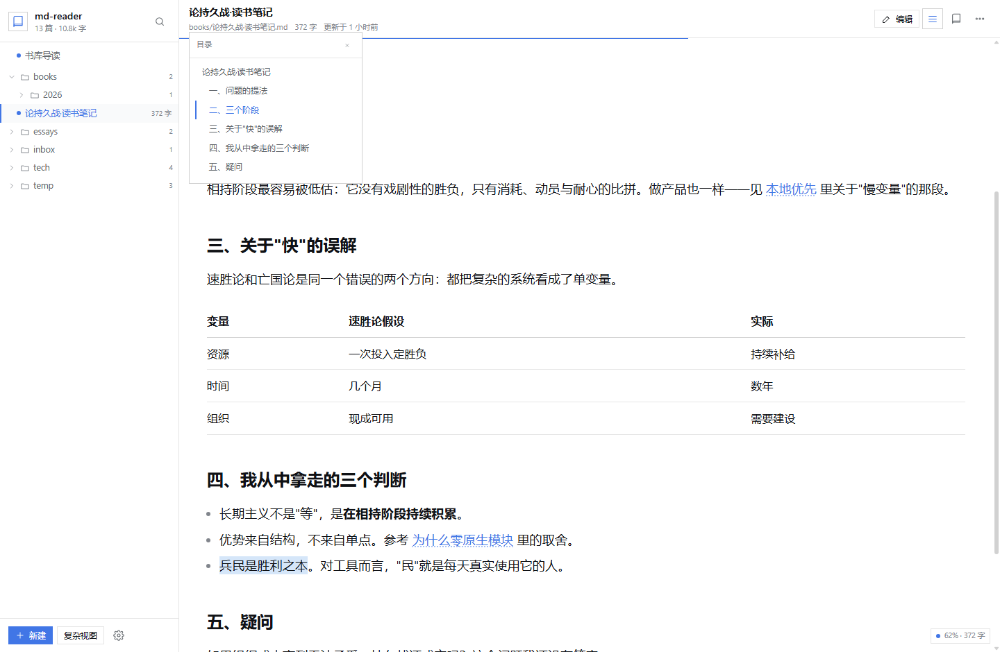
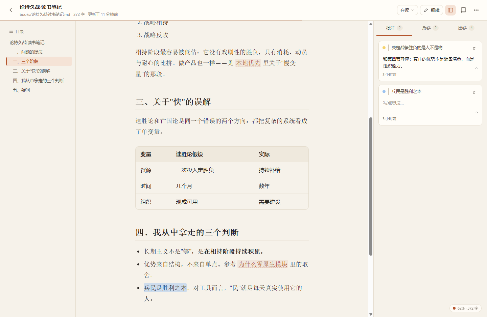
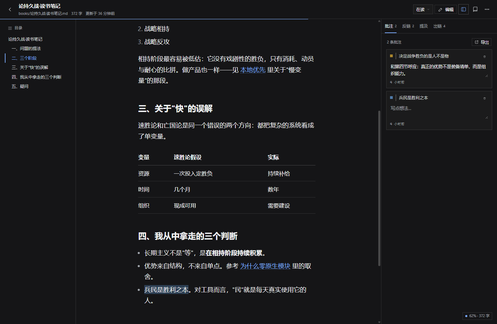
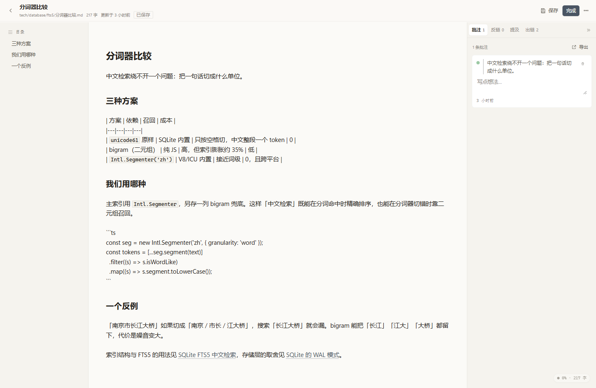
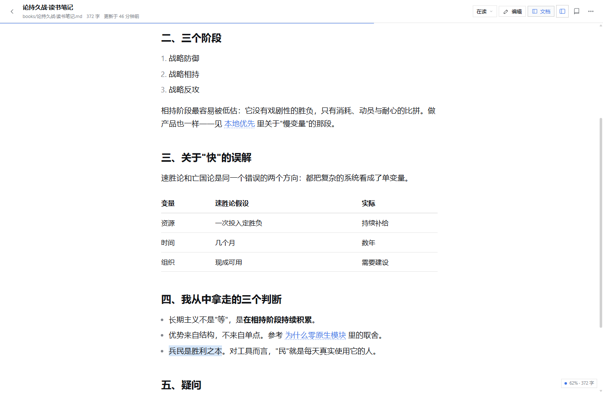
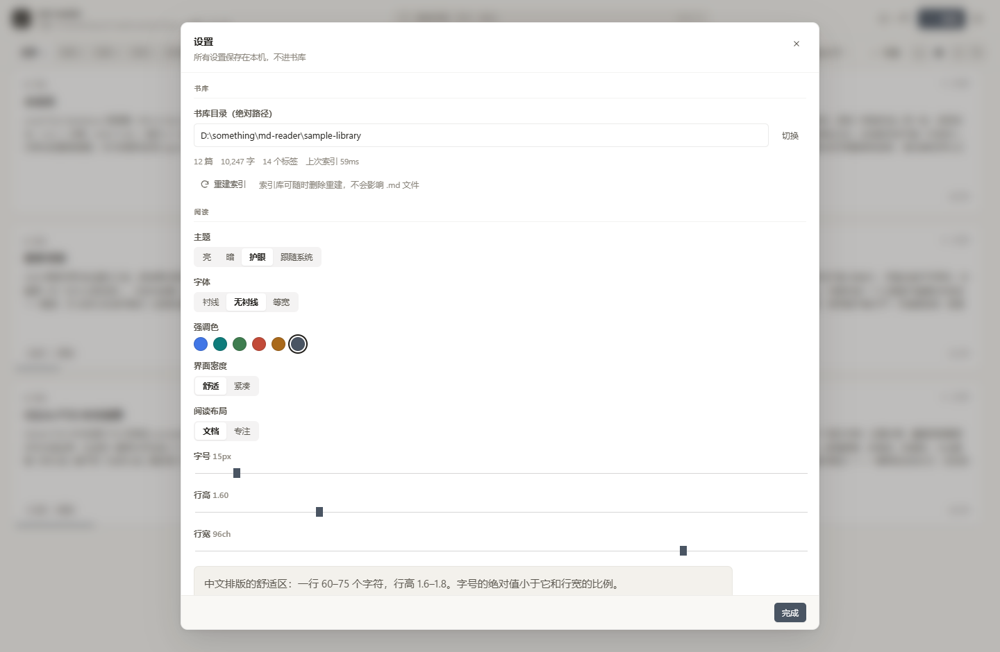
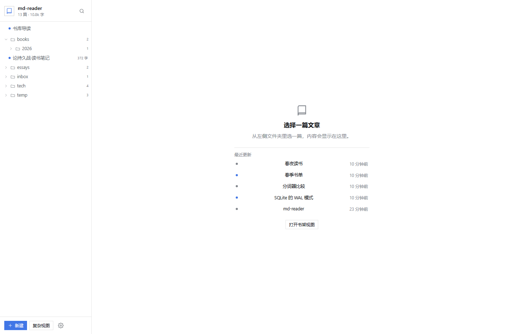

# md-reader

把你硬盘里的 `.md` 变成一个**能舒服地读、能直接改、能全局搜、能划线批注、能互相链接**的私人书库。

本地优先：文件就是数据库。元数据、批注、链接全部写在 Markdown 的 frontmatter 与正文里，同步交给坚果云 / WebDAV / Git 即可。

> 当前状态：**初版可运行**（M1 骨架 + P0 写作 / 批注 / 双链 / 搜索）。剪藏（M5）与安装包（M1.5）尚未实现，见文末「已知限制」。
> 需求基线：[PRD-v3](../PRD-v3.md)。



---

## 现在能做什么

| 能力 | 状态 | 说明 |
|---|---|---|
| 简单视图 | ✅ | 默认主视图：左侧文件树 + 中间文章，**没有未读/在读/已读导航**；目录以浮层打开 |
| 复杂视图 | ✅ | 书架（文件夹 / 卡片 / 列表 / 标签）+ 三栏阅读 + 状态导航，可随时切回简单视图 |
| 书架 | ✅ | 四种视图（文件夹 / 书架 / 列表 / 标签）、嵌套文件夹树、状态分组、标签筛选、排序、虚拟滚动、批量改状态 / 打标签 |
| 阅读器 | ✅ | DSH 风格排版、**文档 / 专注两种布局**、TOC 高亮、沉浸模式、图片灯箱、Shiki 代码高亮 + 行号 + 复制、KaTeX、脚注、任务列表；三主题 + 6 强调色 + 两档密度 |
| 写作 | ✅ | CodeMirror 6 + Live Preview（隐藏标记、标题变大、图片内联、复选框可点）、800ms 自动保存、`Ctrl+S`、冲突检测、粘贴图片 |
| 批注 | ✅ | 4 色高亮 + 旁注，写回 frontmatter；四级锚点重定位；失效批注单独分组、可重新绑定；导出批注为 Markdown |
| 双向链接 | ✅ | `[[文档]]`、`[[文档|显示]]`、`[[文档#标题]]`；反链面板、出链、断链标红、悬浮预览、Unlinked Mentions 一键加链 |
| 搜索 | ✅ | 中文分词 + FTS5（bigram 兜底），200ms 去抖，标题 / 正文 / 标签 / 批注备注 |
| 文件操作 | ✅ | 新建、重命名、移动（同步更新 `[[链接]]`）、删除到 `.trash/`、占位图片上传、拖入 `.md` 导入 |
| 实时 | ✅ | SSE：索引进度、外部改动、删除、配置变更；前端静默刷新 |
| 剪藏 | ⛔ | `POST /clip` 返回 501（P1） |
| 安装包 | ⛔ | Tauri 壳 + Node SEA 未做（M1.5） |

### 界面

| 阅读（亮） | 阅读（暗） |
|---|---|
|  |  |

| 书架（卡片） | 写作（Live Preview） |
|---|---|
|  |  |

| 专注布局（Typora 式单栏） | 设置 |
|---|---|
|  |  |

| 全局搜索 | 紧凑密度 |
|---|---|
|  |  |

| 文件夹视图（复杂视图） | 简单视图空状态 |
|---|---|
|  |  |

### 两种主视图

| 视图 | 结构 | 适合 |
|---|---|---|
| **简单视图（默认）** | 左：文件树（文件夹 + 文档，可展开）｜中：文章 | 日常阅读：打开即读，目录以浮层出现，没有状态筛选干扰 |
| **复杂视图** | 书架（文件夹 / 卡片 / 列表 / 标签）+ 三栏阅读 + 状态导航 | 整理、批量、查看批注与反链 |

- 切换入口：简单视图左下「复杂视图」；书架右上「简单」；阅读器「更多 → 切换到简单视图」。
- 选择写入 `localStorage · mr.app.mode`，刷新后保持。
- 简单视图的目录按钮在阅读器右上角，浮层宽 250px，点击标题跳转并自动关闭。

### 文件夹视图（复杂视图）

- **左侧文件夹树，右侧文件标题列表**：树支持多级嵌套、展开/折叠、每个文件夹显示文档数（含子文件夹）。
- 选中文件夹后，右侧显示该文件夹及其子文件夹下的文档；路径列显示相对路径。
- 标题列表与卡片 / 列表 / 标签视图可随时切换；文件夹树、展开状态、当前文件夹、排序与筛选都会记住。
- 示例书库已加入嵌套目录：`tech/database/`、`tech/database/fts5/`、`books/2026/`、`essays/2026/03/`。

### 阅读布局

阅读页右上角可在两种布局间切换，选择会写入配置，进入/退出文章不会丢：

| 布局 | 说明 |
|---|---|
| **文档** | 三栏：目录 + 正文 + 批注/反链面板；正文撑满中间栏，不再有左右留白 |
| **专注** | Typora 式单栏：隐藏两侧栏，正文居中 68ch，适合连续阅读与写作 |

### 视觉风格

界面参照 **DSH 内置 Markdown 的设计 token** 重做，不是常见的圆角卡片风：

- **直角**：组件 0 圆角，仅行内代码/图片 2px；没有胶囊按钮。
- **线而非影**：用 1px / 0.5px 边框与底色分层，全站无投影、无渐变、无毛玻璃。
- **单一强调色**：默认 DSH 蓝 `#4176e6`，可在设置里换青/绿/朱/琥珀/石墨。
- **排版即品牌**：标题 700、段落 1em、引用 2px 左边线、表格只有横线（与 DSH Markdown 一致）。
- **密度可选**：舒适（3 行摘要）/ 紧凑（2 行摘要，卡片 184px）。
- **暗色**：不是简单反色，按 DSH 的 neutral-bluish 色板重建（`#151517` / `#1b1b1c` / `#7aaaff`）。

完整规范（token 表、组件规则、暗色映射、验收清单）见 [docs/UI-DESIGN.md](docs/UI-DESIGN.md)。

---

## 快速开始

### 环境

- **Node.js ≥ 22.13**（推荐 24 LTS；`node:sqlite`、`Intl.Segmenter`、原生 TS）
- **pnpm ≥ 10**
- Chrome 120+（唯一目标浏览器）

> 本机当前没有全局 Node，开发时可用 DSH 自带的那一份：
>
> ```powershell
> $env:PATH = "C:\Users\<you>\.dsh\dsh-runtimes\dsh-primary-runtime\dependencies\node\bin;C:\Program Files\Git\cmd;" + $env:PATH
> ```
>
> 日常使用建议 `winget install OpenJS.NodeJS.LTS`。

### 运行

```powershell
pnpm install
pnpm build          # 构建前端到 packages/web/dist
pnpm start          # 启动守护进程，随机端口，自动打开 Chrome
```

- 首次启动会在 `~/Documents/md-reader` 创建书库并写一篇欢迎文档；也可以在设置里切换书库，或设置 `READER_ROOT`。
- 端口首次随机分配后记在 `%APPDATA%\md-reader\run.json`，之后优先复用（避免 origin 变化导致设置丢失）。
- 已在运行时会话再次启动 → 只唤起浏览器，不会起第二个进程。

### 开发模式

```powershell
pnpm dev            # 守护进程 :37123 + Vite :5173（带 /api 代理）
```

打开 <http://localhost:5173>。开发数据在项目根的 `.devdata/`（已 gitignore）。

### 测试

```powershell
pnpm test           # 46 个单元测试（编码保真 / frontmatter 局部改写 / 分词 / 渲染 / 锚点重定位 / 索引）
pnpm typecheck
```

端到端 UI 验证（需要本机 Chrome + CDP）：

```powershell
# 1. 启动服务端（见上）
# 2. 启动带调试端口的 Chrome
& "$env:LOCALAPPDATA\Google\Chrome\Application\chrome.exe" --headless=new --remote-debugging-port=9222 `
  --user-data-dir="D:\temp\cdp-profile" about:blank
# 3. 跑流程：编辑 → 自动保存 → Esc → 划线批注 → 状态切换 → 冲突处理
node scripts/ui-flow.mjs
```

截图脚本：`node scripts/shot.mjs <url> <out.png> [宽] [高] [等待ms] [前置JS]`。

另做过一轮 CDP 端到端检查（结果均通过）：Unlinked Mentions 一键加链、Wiki 悬浮预览、拖入 `.md` 导入、批量改状态 / 打标签、暗色主题、新建/移动/删除对话框。

---

## 目录结构

```
md-reader/
├─ packages/server/            # 守护进程（零原生模块，Node 原生 TS）
│  ├─ src/core/                # ULID、hash、编码、EOL、原子写、frontmatter、分词、路径、配置
│  ├─ src/store/db.ts          # node:sqlite + FTS5 schema 与查询
│  ├─ src/library/             # 扫描/索引、fs.watch 监听、文档读写、目录服务
│  ├─ src/http/                # 路由、安全中间件、SSE
│  └─ test/core.test.ts        # 19 个服务端测试
├─ packages/web/               # React 18 + Vite + TS
│  ├─ src/components/          # 书架、阅读器、面板、弹层、搜索、设置
│  ├─ src/editor/              # CodeMirror 6 + Live Preview 装饰
│  ├─ src/lib/                 # markdown-it 管线、批注重锚定、Shiki、DOM 文本
│  ├─ src/styles/              # 主题变量 / 排版 / 编辑器
│  └─ test/                    # 27 个前端纯逻辑测试
├─ sample-library/             # 演示书库（6 篇中文文档，含批注/双链/公式/图）
├─ scripts/                    # dev、测试与 CDP 截图工具
└─ PRD-v3.md（在上级目录）      # 需求基线
```

---

## 文件格式

```markdown
---
title: 论持久战·读书笔记
tags: [历史, 战略]
aliases: [持久战]
created: 2026-10-28T21:10:00+08:00
source:                       # 仅剪藏文档
  url: https://example.com/a
reader:
  id: 01M6PEGRCN1EKDDN8MCEYVHY88   # ULID，文档身份，重命名/移动不变
  status: reading                  # unread | reading | done
  progress: 0.62
  annotations:
    - id: 01M6PEGRC...
      exact: "决定战争胜负的是人不是物"
      prefix: "我们常说，"
      suffix: "，这是历史唯物主义的观点。"
      pos: 96
      color: yellow
      note: "和第四节呼应"
      created: 2026-11-05T22:41:00+08:00
---

正文……
```

写入规则（实现均覆盖测试）：

- **只写 `reader:` 与 `source:`**，绝不覆盖用户字段；
- 修改 frontmatter 用**局部行替换**，保留键序、注释与缩进，git diff 只有目标行；
- **原子写**：同目录 `.tmp` → `fsync` → `rename`，断电不留半截；
- 写回前快照到 `%APPDATA%\md-reader\versions/<docId>/`，默认保留 20 版；
- 保持原文件 **EOL**（CRLF/LF）与原编码（UTF-8 / UTF-8 BOM / UTF-16 / GB18030）；
- 编码无法表示新内容时（例如 GBK 文件里输入 emoji）自动升级为 UTF-8，并在保存响应里标记 `reencoded`。

---

## 架构

```
Chrome (web UI)  ──HTTP / SSE──▶  Node 守护进程 127.0.0.1:<随机端口>
                                     ├─ node:sqlite + FTS5 索引（可删可重建）
                                     ├─ fs.watch({recursive}) 增量
                                     ├─ 原子写 + 版本快照
                                     └─ 书库目录 (.md + assets/ + .trash/)
```

- 后端零依赖编译：`node:sqlite`、`Intl.Segmenter`、`fetch`、`fs.watch` 全内置；仅 `yaml` 与 `iconv-lite` 两个纯 JS 依赖。
- 前端只承诺 Chrome：不引 polyfill、不做兼容矩阵，直接用 `Intl`、Popover、`:has()` 等。
- 索引纯缓存：删掉 `index.db` 会全量重建，不影响文件。

### API（前缀 `/api/v1`）

| 方法 | 路径 | 说明 |
|---|---|---|
| GET | `/health` | 实例信息、端口、书库 |
| GET | `/library` · `/library/stats` · `/library/dirs` | 书库与索引状态 |
| POST | `/library/open` · `/library/rescan` | 挂载 / 重建索引 |
| GET | `/docs` | 列表（status / tag / sort / q） |
| GET | `/docs/:id` | 元数据 + 正文 + 批注 + 反链 + hash |
| POST | `/docs` | 新建 `{dir,title,content?}` |
| PATCH | `/docs/:id` | 保存 `{body, baseHash}`，冲突 409 |
| POST | `/docs/:id/status` | 改阅读状态 |
| POST | `/docs/:id/move` | 移动 / 重命名（可选更新反链） |
| DELETE | `/docs/:id` | 移入 `.trash/` |
| POST/PATCH/DELETE | `/docs/:id/annotations[/:aid]` | 批注增改删 |
| | `/docs/:id/backlinks` · `/links` · `/mentions` | 反链 / 出链 / 未链接提及 |
| GET | `/search` · `/tags` · `/preview` | 搜索 / 标签 / 悬浮预览 |
| POST | `/assets` | 图片二进制上传（`image/*`，`docId` 查询参数） |
| GET | `/files?path=` | 书库内图片 |
| POST | `/clip` | 剪藏（未实现，501） |
| GET | `/events` | SSE：index-progress / doc-changed / doc-removed / links-changed |

**安全**（PRD §4.3）：仅绑定 `127.0.0.1`；变更请求必须 `X-Reader-Client: 1` + JSON（图片除外），跨源 `Origin` 一律 403；CSP 禁 inline script（Shiki 的 WASM 额外放行 `'wasm-unsafe-eval'`）。

---

## 性能实测（本机 Windows 11 / Node 24.21）

用 `scripts/bench.mjs` 生成 3000 篇中文文档（约 1KB/篇）实测：

| 指标 | 结果 | PRD 目标 |
|---|---|---|
| 冷启动全量索引 | **20.3s**（3000 篇） | < 30s |
| 搜索 p50 / p95 | **18.6ms / 22.0ms** | < 50ms |
| `/docs` 列表（3000 篇） | 78ms | — |
| 增量索引（单篇保存） | < 100ms（含写盘与 SSE） | < 3s |

> 中文召回用真实语料另测；`Intl.Segmenter` + bigram 兜底在演示库与 3000 篇压测中均正常。

---

## 设计取舍（与 PRD 一致的部分）

- **不兼容 Logseq graph**：只解析 `[[ ]]`，不解析 `- ` 大纲与 `key:: value`。
- **路径不是身份**：文档身份是 ULID；库内只存 POSIX 相对路径；Unicode 比较前统一 NFC（只比较不改写）。
- **随机粘性端口**：首次 `listen(0)`，之后复用 `run.json` 里的端口。
- **写作是 P0**：编辑的是 Markdown 源码，Live Preview 只做装饰，保存后仍是干净的 Markdown。
- **不做 WYSIWYG 表格**：表格在编辑器里就是源码 + 等宽对齐（PRD 明确不做块拖拽 / 富文本表格）。

---

## 已知限制与偏差

| 项 | 现状 | 计划 |
|---|---|---|
| 剪藏 | API 501，界面无入口 | M5：Readability + turndown + 图片本地化 |
| 打包 | 无安装包 / 托盘 | M1.5：Tauri 壳 + SEA sidecar（PRD 建议尽早做） |
| 逐行合并 | 冲突对话框里的**手动合并面板**（磁盘版 / 我的版 / 可编辑结果），非自动 diff3 | 后续接 `@codemirror/merge` 或自研 hunk |
| 文内查找 | 用 Chrome 原生 `Ctrl+F` | 自定义高亮跳转 |
| 批量移动 | 批量改状态 / 打标签已做，批量移动目录未做 | 复用移动对话框 |
| 大文档渲染 | 一次性渲染，>10 万字未分块 | PRD 风险表已列 |
| 编辑器表格 | 源码编辑（符合 PRD） | — |
| 性能 | 3000 篇已压测（见上），30 万篇未测 | 后续评估 |

---

## 下一步

1. **M1.5 打包验证**：Tauri 壳 + SEA sidecar + 托盘，尽早暴露安装风险；
2. 剪藏（M5）；
3. 批量操作、导出批注、拖入文件等写作/书架细节；
4. 3000 篇性能实测与索引增量优化。

## 许可

私人自用项目，未定许可证。
